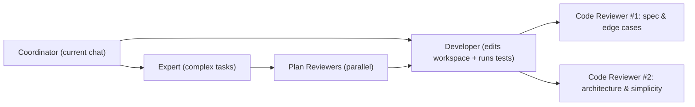

# Paseo Team

English | [简体中文](./README.zh-CN.md)

[](https://github.com/OliverWalker1122/paseo-team/actions/workflows/ci.yml)
[](https://github.com/OliverWalker1122/paseo-team/actions/workflows/ci.yml)
[](./LICENSE)
[](./package.json)
[](https://paseo.sh)

A lightweight [Paseo](https://paseo.sh) plugin for role-separated multi-agent coding: pick models per role once, toggle **Team mode** in any composer (including New Workspace), and inspect the live agent graph powered directly by Paseo's native sessions.

## Why

When one agent writes code and judges its own work, it often misses its own blind spots. At the same time, heavy plugin-side state machines drift out of sync with the host app. Paseo Team keeps things simple:

- **Single source of truth**: Paseo's live agent tree is the only state. There is no local `task.json` state machine, no stale workspace lock, and no regex parsing of model replies.
- **Native Paseo orchestration**: Your open chat acts as Coordinator and dispatches Developer and Reviewers strictly through Paseo's native `create_agent` / `send_agent_prompt` callbacks.
- **Direct model setup**: Configure provider, model, and reasoning effort per role once in **Team → Setup**.

## Features

- **Composer Team toggle everywhere**: Click the **Users** (`Team mode`) toggle in the composer toolbar on **New Workspace**, **draft chats**, or **existing chats** — or run `/paseo-team <goal>` directly.
- **Separated roles**: Coordinator owns scope, acceptance criteria, dispatch, and adjudication. Only Developer edits product files; Reviewers run tests or reproduction checks without modifying code.
- **Adversarial cross review**: Two reviewers check each change independently from opposing angles (spec & edge cases vs. architecture & simplicity), capped at 2 rounds before handing trade-offs back to you.
- **Your workspace, your commits**: Subagents inherit your open Paseo workspace (local checkout or Paseo worktree) without hidden `.worktrees` or unsolicited commits.
- **Live agent graph**: One shared **Team graph** tab per workspace shows every live subagent wave directly from Paseo, with one-click session jump and a **Back to main chat** button.
- **English and Chinese**: UI follows the Paseo app language; agent instructions follow the language of your prompt.

## Requirements

- Paseo 0.17.3 or later
- At least one connected agent provider, such as Claude, Codex, Antigravity or Pi
- Node.js 22.18 or later (for plugin development only)

## Installation

Install from GitHub:

```bash
paseo plugin add git:OliverWalker1122/paseo-team
```

Or install from a local clone:

```bash
git clone https://github.com/OliverWalker1122/paseo-team.git
cd paseo-team
npm ci
paseo plugin add "$(pwd)"
```

After editing a local clone, run `paseo plugin reload paseo-team`.

## Usage

1. Open **Team → Setup** in the Paseo sidebar and pick a model for each role.
2. Start a team session in either way:
   - On **New Workspace** or a **draft chat**: turn on the **Team mode** (`Users`) toggle in the composer toolbar and send your task directly.
   - In an **existing chat**: run `/paseo-team <task goal>` (or click the **Team mode** toggle).
3. Click the **Team** pill above the composer to inspect the live agent graph and jump between sessions.

### Commands

| Command                   | What it does                                         |
| ------------------------- | ---------------------------------------------------- |
| `/paseo-team <task goal>` | Starts a team workflow with this chat as coordinator |
| `/paseo-team setup`       | Opens role model and preset setup                    |
| `/paseo-team status`      | Opens the workspace live team graph                  |

### Optional phrases in the goal

| Phrase              | Effect                                    |
| ------------------- | ----------------------------------------- |
| `with review`       | Require code review                       |
| `plan review`       | Require plan review before implementation |
| `no review`         | Skip review for this request              |
| `expert mode`       | Dispatch a dedicated Expert for planning  |
| `simple mode`       | Coordinator drafts the plan itself        |
| `use preset <name>` | Use a preset other than the default       |

Chinese equivalents are supported too; see [README.zh-CN.md](./README.zh-CN.md).

## Architecture



- **Server hooks (2 total)**:
  - `agent.open.before`: injects role guides for team subagents (zero custom tools), directly injects the resolved role roster + team protocol when Team mode is enabled on a new chat, and provides a tiny read-only `paseo_team_roster` fallback tool on normal chats.
  - `agent.permission.before`: auto-allows read-only `paseo_team_roster` and native Paseo orchestration calls on team-enabled coordinators.
- **Graph & pills**: derived 100% live from Paseo's native agent tree (`parentAgentId` and `labels["paseo.parent-agent-id"]`).

## Configuration

Settings are saved to `~/.config/paseo-team/config.json` (or `$XDG_CONFIG_HOME/paseo-team/config.json`) in schema v5:

```json
{
  "schemaVersion": 5,
  "default": "Standard",
  "teams": {
    "Standard": {
      "developer": { "model": "codex/gpt-6.1-sol", "thinking": "high" },
      "codeReviewers": [
        { "model": "claude/claude-opus-5-5", "thinking": "high" },
        { "model": "codex/gpt-6-astra", "thinking": "high" }
      ],
      "separatePlanReviewers": false,
      "planReviewers": [],
      "complexMode": "simple"
    }
  },
  "projects": {}
}
```

## Security and privacy

- Everything stays local on your machine. The plugin has no telemetry and makes no external network calls.
- All role instructions enforce credential redlines (never read `.env*` or dump environment variables; run checks with `SKIP_DOTENV=true DOTENV_CONFIG_PATH=/dev/null`).

To report a vulnerability, see [SECURITY.md](./SECURITY.md).

## Development

```bash
npm ci
npm run ci               # format check, Markdown lint, typecheck, plugin audit, L1 + L2 tests
npm run test:unit        # L1: unit, prompt, handler & client UI tests (offline, <1s)
npm run test:integration # L2: server hooks, RPCs & subscriptions integration tests (offline, <1s)
npm run test:coverage    # L1 + L2 with Node native coverage report and 80% line gate
npm run coverage:badge   # regenerate .github/badges/coverage.svg
npm run test:e2e         # L3: live Paseo daemon E2E smoke test (opt-in)
npm run format           # apply Prettier
```

Client code must stay cross-platform (React Native primitives + `@getpaseo/plugin/client/ui` only, no DOM or `node:` imports). `npm run check:plugin` enforces this.

## Contributing

Issues and pull requests are welcome. Please read [CONTRIBUTING.md](./CONTRIBUTING.md) and [CODE_OF_CONDUCT.md](./CODE_OF_CONDUCT.md) first.

## License

[MIT](./LICENSE) © OliverWalker1122
