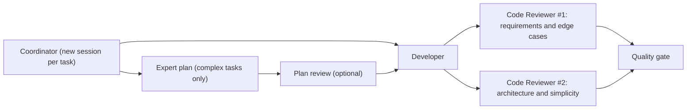

# Paseo Team

English | [简体中文](./README.zh-CN.md)

[](https://github.com/OliverWalker1122/paseo-team/actions/workflows/ci.yml)
[](./LICENSE)
[](https://paseo.sh)

A [Paseo](https://paseo.sh) plugin that turns one chat into a small engineering team. Each task gets its own coordinator session that scopes the work and makes the calls, a developer writes the code, and two code reviewers check it from opposing angles before a quality gate signs off.

## Why

When one agent writes code and then judges its own work, it tends to approve its own blind spots. Paseo Team splits those jobs across separate agent sessions, gives each one only the permissions it needs, and records every verdict as evidence you can inspect later.

## Features

- **Separated roles.** A new coordinator session per task scopes the work and dispatches one Developer at a time. Reviewers do not edit product code, while remaining free to run tests or reproduction checks to verify edge cases.
- **Checked handoffs.** Every member hands off through its own submit tool (delivery, plan or review). The tool rejects malformed input or a delivery without a passing check, and the plugin reminds a member once if its turn ends without submitting.
- **Cross review.** Two reviewers examine each change independently from opposing angles (requirements and real edge cases vs. architecture and simpler alternatives). Neither sees the other's verdict.
- **Two-round limit.** If review still fails after two rounds, the team stops and asks you instead of patching endlessly.
- **Quality gate.** A task completes only when four evidence checks pass, and a blocked gate lists exactly what is missing and from whom (see [Quality gate](#quality-gate)).
- **Your workspace, your commits.** Agents work in the Paseo workspace you opened: a project folder or a Paseo-managed worktree. The plugin never creates hidden worktrees and never commits or merges, so every edit shows up in Paseo's Changes panel and you decide when to commit.
- **Pick models per role.** Choose provider, model and reasoning effort for each role, or leave it on Auto. Auto gives the reviewers a different provider than the Developer.
- **Live graph per chat.** A chat can start several team tasks; its graph shows each one as a subtree under that chat. History keeps every task, including each review round and its findings.
- **English and Chinese.** The UI follows the Paseo app language. Agent prompts follow the language of your task goal.

## Requirements

- Paseo 0.17.3 or later
- At least one connected agent provider, such as Claude, Codex, Antigravity or Pi
- Node.js 22.18 or later, only if you want to develop the plugin

## Installation

Install from GitHub:

```bash
paseo plugin add git:OliverWalker1122/paseo-team
```

Or install from a local clone, which is handy for development:

```bash
git clone https://github.com/OliverWalker1122/paseo-team.git
cd paseo-team
npm ci
paseo plugin add "$(pwd)"
```

After editing a local clone, run `paseo plugin reload paseo-team`.

## Usage

1. Optional: open **Team** in the Paseo sidebar and pick a model for each role. Auto works without any setup.
2. In any chat, describe the task:

   ```text
   /paseo-team Add a clear command to todo.mjs that removes finished items, with review
   ```

3. Follow progress from the **Team graph** button on the chat composer. Finished tasks stay under **Team → History**.

### Commands

| Command                   | What it does                                    |
| ------------------------- | ----------------------------------------------- |
| `/paseo-team <task goal>` | Starts a team task in a new coordinator session |
| `/paseo-team setup`       | Opens model and preset setup                    |
| `/paseo-team status`      | Opens this chat's team graph                    |

### Phrases you can add to the goal

| Phrase              | Effect                                     |
| ------------------- | ------------------------------------------ |
| `with review`       | Always run code review                     |
| `plan review`       | Review the plan before any code is written |
| `no review`         | Skip code review and record the reason     |
| `expert mode`       | A dedicated expert session writes the plan |
| `simple mode`       | The coordinator writes the plan itself     |
| `use preset <name>` | Use a preset other than the default        |

Chinese equivalents are recognized too; see the [Chinese README](./README.zh-CN.md).

Without `with review`, the coordinator decides whether code review is needed; it is told to start one when a change touches more than 5 files, exceeds 200 lines, or affects the architecture.

## How it works



| Role                  | Can edit files  | Job                                                                                  |
| --------------------- | --------------- | ------------------------------------------------------------------------------------ |
| Coordinator           | No              | Sets scope and acceptance criteria, dispatches agents, rules on findings, signs off  |
| Expert (optional)     | Task notes only | Writes the design and root-cause analysis for complex work                           |
| Developer             | Yes             | Implements changes, runs the full test suite and submits the delivery                |
| Code Reviewer #1 / #2 | No              | Review from opposing angles; can run tests or reproduction checks to verify findings |

### Quality gate

| Check             | Passes when                                                                         |
| ----------------- | ----------------------------------------------------------------------------------- |
| Delivery recorded | The Developer's change summary is on file                                           |
| CI passed         | The latest full test run passed, and ran after the previous rework round's delivery |
| Plan review       | Every plan reviewer in the latest round approved, or plan review was not needed     |
| Code review       | Every reviewer in the latest round approved, or code review was not needed          |

Reviewers that were dispatched but never submitted also block the gate. The gate checks recorded evidence only; it never hashes the workspace, so your own edits or commits do not block it. When a review fails its second round, the task is flagged and the coordinator asks you to decide; **Allow one more round** in the graph grants one more.

## Configuration

Settings are edited in **Team → Setup** and saved to `~/.config/paseo-team/config.json` (or `$XDG_CONFIG_HOME/paseo-team/config.json`).

```json
{
  "schemaVersion": 5,
  "default": "Standard",
  "teams": {
    "Standard": {
      "developer": { "model": "auto" },
      "codeReviewers": [
        { "model": "claude/claude-opus-5-5", "thinking": "high" },
        { "model": "codex/gpt-6-astra", "thinking": "high" }
      ],
      "separatePlanReviewers": false,
      "planReviewers": [],
      "complexMode": "simple"
    }
  },
  "projects": {}
}
```

- A **preset** is a named set of role models. New tasks use `default` unless the goal names another preset.
- `"model": "auto"` picks a ready model at launch. Remove the second code reviewer to run with one.
- `complexMode` decides who writes the plan for complex tasks: `simple` (the coordinator) or `expert` (a dedicated session).

Task records, CI logs and review records are kept per project under `~/.local/state/paseo-team/` (or `$XDG_STATE_HOME/paseo-team/`).

## Security and privacy

- Everything stays on your machine. The plugin has no telemetry and makes no network calls of its own.
- Agents are told never to read `.env` files or dump environment variables. The CI runner sets `SKIP_DOTENV=true` and `DOTENV_CONFIG_PATH=/dev/null` and never writes command arguments to its logs.
- Having credentials available never authorizes deploying, trading, messaging or changing remote data.

To report a vulnerability, see [SECURITY.md](./SECURITY.md).

## Development

```bash
npm ci
npm run ci        # format check, Markdown lint, typecheck, plugin audit, tests
npm run format    # apply Prettier
```

| Path                                     | Contents                                               |
| ---------------------------------------- | ------------------------------------------------------ |
| [paseo-plugin.json](./paseo-plugin.json) | Plugin manifest                                        |
| [index.client.tsx](./index.client.tsx)   | Client entry: sidebar, screens, panels, commands       |
| [index.server.ts](./index.server.ts)     | Server entry: RPC handlers, agent hooks, agent tools   |
| [client/](./client)                      | Setup screen, team graph, history, composer button     |
| [server/](./server)                      | Task records, quality gate, CI runner, prompts, config |
| [shared/](./shared)                      | Typed RPC contracts and English/Chinese strings        |
| [tests/](./tests)                        | Node test runner suites                                |

Client code must stay cross-platform: React Native primitives only, no DOM and no `node:` imports. `npm run check:plugin` enforces this.

## Contributing

Issues and pull requests are welcome. Please read [CONTRIBUTING.md](./CONTRIBUTING.md) first.

## License

[MIT](./LICENSE) © OliverWalker1122
