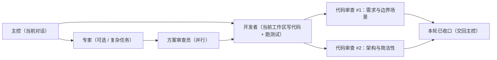

# Paseo Team

[English](./README.md) | 简体中文

[](https://github.com/OliverWalker1122/paseo-team/actions/workflows/ci.yml)
[](https://github.com/OliverWalker1122/paseo-team/actions/workflows/ci.yml)
[](./LICENSE)
[](./package.json)
[](https://paseo.sh)

一个轻量级的 [Paseo](https://paseo.sh) 角色分离多 Agent 协作插件：一次配好各角色模型、推理强度与权限模式，在任意输入框（含「新建 workspace」）一键点亮**团队模式**，直接基于 Paseo 原生会话树查看实时团队 DAG 视图。

## 设计理念

同一个 Agent 既写代码又自审，容易对自身盲点放行；而维护一套复杂的私有磁盘状态机，又容易和宿主状态漂移冲突。Paseo Team 坚持极简单一真源：

- **单一真源**：直接以 Paseo 实时会话树作为唯一状态来源，彻底去掉私有 `task.json` 状态机、本地锁和回复正则解析。
- **纯原生 Paseo 协作**：当前对话直接作为主控，通过 Paseo 原生 `create_agent` / `send_agent_prompt` 派发开发者与审查员并接收异步回调，零自定义交接工具。
- **按角色配置模型与权限**：在 **团队 → 配置** 里按角色选好提供商、模型、推理强度与权限模式（如 `auto`、`full-access`、`bypassPermissions`），修改自动保存并全局复用。

## 功能

- **全场景输入框「团队模式」开关**：在 **新建 workspace**、**草稿对话** 和 **已有对话** 的底部工具栏都提供双人图标开关，点亮后直接发需求即可；也支持 `/paseo-team <任务目标>`。
- **清晰角色分离与 Token 纪律**：
  - **主控**：在 `simple` 模式下兼任架构师（负责根因分析、抽象分层、范围划定、派发与裁决），不直接修改业务代码或跑测试套件；强调并发只读查询、避免重复拉取全量日志和上万字全量 `git diff`。
  - **开发者**：唯一可修改工作区代码并运行测试的角色（同一时刻仅一名，返工轮复用原会话）。
  - **代码与方案审查员**：两位审查员从对立视角（**需求规格与真实边界场景** vs **架构一致性与复杂度删减**）独立交叉审查，最多 2 轮，仍未达成一致则整理取舍交由你裁定。
  - 可选 **专家（`expert` 模式）**：在超大型跨服务调研任务中隔离重度读码上下文，只把精炼方案带回主控。
- **你的工作区，你来掌控 Git**：子会话直接继承你当前打开的 Paseo 工作区（本地目录或 Paseo worktree），不建隐藏 `.worktrees`，不擅自切分支、`git merge` 或 `git push`。
- **实时团队视图与运行中/历史分栏**：
  - 每个工作区共享一个 **团队** 标签页，服务端通过单条共享的 Paseo daemon 实时订阅流（`agents.list({ subscribe: {} })` + 运行中对账兜底）推送变更；卡片展示清晰角色名、模型与「已完成」状态，本轮收口后底部呈现 **交回主控 → 本轮已收口** 终结节点，支持一键跳转主控或任意子会话。
  - 侧边栏 **团队** 页面默认进入 **运行中**（多任务时顶部横向切换），已完成协作归入 **历史** 纵向列表（点击原地展开 DAG 图），**配置** 页默认全展开无折叠隐藏项。
- **纯中文与英文双语**：中文界面统一使用纯中文角色名（主控 / 开发者 / 专家 / 方案审查 / 代码审查 / 子会话），Agent 指引自动跟随你的需求语言。

## 环境要求

- Paseo 0.17.3 或更高版本
- 至少连接一个 Agent 提供商（如 Claude、Codex、Antigravity 或 Pi）
- Node.js 22.18 或更高版本（仅开发插件时需要）

## 安装

从 GitHub 安装：

```bash
paseo plugin add git:OliverWalker1122/paseo-team
```

或从本地克隆安装：

```bash
git clone https://github.com/OliverWalker1122/paseo-team.git
cd paseo-team
npm ci
paseo plugin add "$(pwd)"
```

修改本地代码后运行 `paseo plugin reload paseo-team` 即可生效。

## 使用

1. 在 Paseo 侧边栏打开 **团队 → 配置**，为各角色选择模型、推理强度与权限模式（例如把开发者设为 `Full access` / `Bypass`，减少开发过程中的频繁授权打断）。
2. 任选以下方式启动团队协作：
   - **新建 workspace / 草稿对话**：点亮输入框底部的双人「团队模式」图标，直接输入需求发送。
   - **已有对话**：输入 `/paseo-team <任务目标>`，或点击底部「团队模式」图标自动补全前缀。
3. 点击输入框上方的 **团队** 胶囊打开实时团队视图，点击任意角色卡片查看详情或一键进入对应会话。

### 命令

| 命令                     | 作用                         |
| ------------------------ | ---------------------------- |
| `/paseo-team <任务目标>` | 以当前对话为主控启动团队协作 |
| `/paseo-team setup`      | 打开角色模型、权限与预设配置 |
| `/paseo-team status`     | 打开当前工作区的实时团队视图 |

### 可选内联短语

| 短语                                 | 效果                       |
| ------------------------------------ | -------------------------- |
| `需要审查` / `开启审查` / `必须审查` | 明确要求开启代码审查       |
| `方案审查`                           | 写代码前先进行方案评审     |
| `不要审查` / `跳过审查` / `免审`     | 本次跳过审查               |
| `用专家模式`                         | 复杂任务派独立专家起草方案 |
| `用简单模式`                         | 复杂任务由主控起草方案     |
| `用 <名称> 预设`                     | 临时使用指定预设           |

英文短语同样支持，见 [README.md](./README.md)。

## 架构说明



- **仅 2 个服务端 Hook**：
  - `agent.open.before`：为团队子会话注入对应角色精简指引（零自定义工具）；新建对话开启团队模式时直接注入完整角色参数表与协作协议（首轮直达、无需额外查工具）；普通对话附带一个只读 `paseo_team_roster` 兜底工具。
  - `agent.permission.before`：为团队主控自动放行只读 `paseo_team_roster` 与 Paseo 原生编排工具调用。
- **共享实时订阅中心**：服务端维护单条引用计数的 daemon `agents.list({ subscribe: {} })` 长连接，实时驱动所有「团队」面板、运行中/历史页与工作区角标，支持断线重连全量快照覆盖和运行中 15 秒低频对账兜底。

## 配置

配置保存在 `~/.config/paseo-team/config.json`（或 `$XDG_CONFIG_HOME/paseo-team/config.json`），兼容 schema v5：

```json
{
  "schemaVersion": 5,
  "default": "Standard",
  "teams": {
    "Standard": {
      "developer": {
        "model": "antigravity/gemini-4-neon",
        "thinking": "xhigh",
        "mode": "full-access"
      },
      "codeReviewers": [
        { "model": "claude/claude-opus-5-5", "thinking": "high" },
        { "model": "codex/gpt-6.2-astra", "thinking": "high" }
      ],
      "separatePlanReviewers": false,
      "planReviewers": [],
      "complexMode": "simple"
    }
  },
  "projects": {}
}
```

某角色省略 `mode` 时，会自动按提供商推荐模式回退（`auto-review` → `auto` → 开发者用 `acceptEdits` → 提供商默认模式）。

## 安全与隐私

- 所有配置与状态完全留在本地，无遥测，插件自身不发起任何外部网络请求。
- 所有角色指引强制要求凭据隔离（禁止读取 `.env*`、禁止导出环境变量；格式化、lint 与单测须加 `SKIP_DOTENV=true DOTENV_CONFIG_PATH=/dev/null`）。

报告安全漏洞请见 [SECURITY.md](./SECURITY.md)。

## 开发

```bash
npm ci
npm run ci               # 格式检查、Markdown 检查、类型检查、插件审计、L1 + L2 测试
npm run test:unit        # L1：配置、提示词、处理器与前端 UI 单元测试（离线，<1s）
npm run test:integration # L2：服务端 Hook、RPC 与实时订阅集成测试（离线，<1s）
npm run test:coverage    # L1 + L2 覆盖率报告与 80% 行覆盖率门槛
npm run coverage:badge   # 更新覆盖率徽章
npm run test:e2e         # L3：真实 Paseo 实跑验收（按需手动触发）
npm run format           # Prettier 格式化
```

客户端代码必须保持跨平台（仅用 React Native 基础组件与 `@getpaseo/plugin/client/ui`，禁用 DOM 与 `node:` 模块），`npm run check:plugin` 会自动审计。

## 参与贡献

欢迎提交 Issue 和 Pull Request，请先阅读 [CONTRIBUTING.md](./CONTRIBUTING.md) 与[行为准则](./CODE_OF_CONDUCT.md)。

## 许可证

[MIT](./LICENSE) © OliverWalker1122
