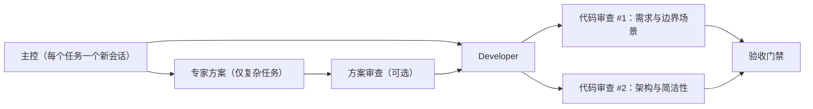

# Paseo Team

[English](./README.md) | 简体中文

[](https://github.com/OliverWalker1122/paseo-team/actions/workflows/ci.yml)
[](./LICENSE)
[](https://paseo.sh)

一个 [Paseo](https://paseo.sh) 插件，把一个对话变成一支小型开发团队：每个任务有自己的主控会话负责定范围、做决定，Developer 写代码，两位代码审查员从对立的角度检查，最后由验收门禁确认完成。

## 为什么需要它

同一个 Agent 既写代码又评判自己的代码，很容易对自己的盲点放行。Paseo Team 把这几件事拆给不同的 Agent 会话，每个会话只拿到它需要的权限，每次审查结论都留档，事后可以查。

## 功能

- **角色分离**：每个任务新开一个主控会话负责定范围与统筹，同一时刻只派一名 Developer 写代码；审查员只审不改业务代码，但可以自由跑测试或复现命令核实边界问题。
- **交接有检查**：每个成员用自己的提交工具交接（交付、方案或审查结论）。格式不对、或交付时检查没通过，工具会直接退回；成员一轮结束却没提交，插件会提醒一次。
- **交叉审核**：两位审查员从对立视角独立审查每次改动：一位看需求和真实边界场景，一位看架构和更简单的方案。彼此看不到对方的结论。
- **两轮上限**：审查两轮仍不通过时，团队会停下来请你决定，不会无休止地打补丁。
- **验收门禁**：只有 4 项证据检查全部通过，任务才算完成；未通过时会逐条列出缺什么、该找谁（见[验收门禁](#验收门禁)）。
- **你的工作区，你来提交**：Agent 就在你打开的 Paseo 工作区里工作，可以是项目目录，也可以是 Paseo 管理的 worktree。插件不会建隐藏的 worktree，也不会提交或合并代码，所有改动都显示在 Paseo 的更改面板里，什么时候提交由你决定。
- **按角色选模型**：每个角色都可以选 Provider、模型和推理强度，也可以保持“自动”。自动模式会让审查员用和 Developer 不同的 Provider。
- **每个对话一张实时状态图**：一个对话可以启动多个团队任务，状态图把每个任务画成该对话下的一棵子树。历史记录保留每个任务，包括每一轮审查和提出的意见。
- **中英文界面**：界面跟随 Paseo 的应用语言，Agent 提示词跟随任务目标所用的语言。

## 环境要求

- Paseo 0.17.3 或更高版本
- 至少连接一个 Agent Provider，例如 Claude、Codex、Antigravity 或 Pi
- Node.js 22.18 或更高版本（仅开发插件时需要）

## 安装

从 GitHub 安装：

```bash
paseo plugin add git:OliverWalker1122/paseo-team
```

也可以从本地克隆安装，方便开发：

```bash
git clone https://github.com/OliverWalker1122/paseo-team.git
cd paseo-team
npm ci
paseo plugin add "$(pwd)"
```

修改本地代码后，运行 `paseo plugin reload paseo-team` 生效。

## 使用

1. 可选：在 Paseo 侧边栏打开 **团队**，为每个角色选择模型。不做任何设置也能直接用“自动”。
2. 在任意对话里描述任务：

   ```text
   /paseo-team 为 todo.mjs 新增 clear 子命令，删除所有已完成的待办；需要审查
   ```

3. 点击对话输入框上方的 **团队状态图** 按钮查看进度。完成的任务保存在 **团队 → 历史** 里。

### 命令

| 命令                     | 作用                               |
| ------------------------ | ---------------------------------- |
| `/paseo-team <任务目标>` | 新开一个主控会话，启动一个团队任务 |
| `/paseo-team setup`      | 打开模型与预设配置                 |
| `/paseo-team status`     | 打开当前对话的团队状态图           |

### 目标里可以加的短语

| 短语                                 | 效果                     |
| ------------------------------------ | ------------------------ |
| `需要审查` / `开启审查` / `必须审查` | 一定进行代码审查         |
| `方案审查`                           | 写代码之前先审查方案     |
| `不要审查` / `跳过审查` / `免审`     | 跳过代码审查，并记录原因 |
| `用专家模式`                         | 由独立的专家会话起草方案 |
| `用简单模式`                         | 由主控自己起草方案       |
| `用 <名称> 预设`                     | 使用默认以外的预设       |

英文短语同样有效，见[英文 README](./README.md)。

没有写“需要审查”时，由主控判断是否需要代码审查；提示词要求它在改动超过 5 个文件、超过 200 行或影响架构时开启。

## 工作原理



| 角色             | 能否改文件   | 职责                                             |
| ---------------- | ------------ | ------------------------------------------------ |
| 主控             | 否           | 定范围和验收标准，派发 Agent，裁定审查意见，签收 |
| 专家（可选）     | 只写任务笔记 | 为复杂任务起草设计方案和根因分析                 |
| Developer        | 是           | 实现改动、运行完整测试并提交交付                 |
| 代码审查 #1 / #2 | 否           | 从对立视角独立审查，可运行测试或复现命令验证边界 |

### 验收门禁

| 检查项     | 通过条件                                             |
| ---------- | ---------------------------------------------------- |
| 已登记交付 | Developer 的改动摘要已登记                           |
| CI 通过    | 最近一次完整测试通过，且跑在上一轮返工交付之后       |
| 方案审查   | 最新一轮的方案审查员全部通过，或本任务不需要方案审查 |
| 代码审查   | 最新一轮的代码审查员全部批准，或本任务不需要代码审查 |

已派出但没有提交结论的审查员也会卡住门禁。门禁只核对已登记的证据，不对工作区做哈希，所以你自己改文件或提交都不会让它卡住。审查第二轮仍未通过时，任务会被标记，由主控请你裁定；在状态图里点 **允许再审一轮** 可以再加一轮。

## 配置

在 **团队 → 配置** 里修改，保存在 `~/.config/paseo-team/config.json`（或 `$XDG_CONFIG_HOME/paseo-team/config.json`）。

```json
{
  "schemaVersion": 5,
  "default": "Standard",
  "teams": {
    "Standard": {
      "developer": { "model": "auto" },
      "codeReviewers": [
        { "model": "claude/claude-opus-5-5", "thinking": "high" },
        { "model": "codex/gpt-6-astra", "thinking": "high" }
      ],
      "separatePlanReviewers": false,
      "planReviewers": [],
      "complexMode": "simple"
    }
  },
  "projects": {}
}
```

- **预设**是一组命名好的角色模型配置。新任务默认使用 `default`，除非目标里指定了其他预设。
- `"model": "auto"` 会在启动时挑选一个可用模型。删掉第二位代码审查员，就是单人审查。
- `complexMode` 决定复杂任务由谁起草方案：`simple`（主控）或 `expert`（独立专家会话）。

任务记录、CI 日志和审查记录按项目保存在 `~/.local/state/paseo-team/`（或 `$XDG_STATE_HOME/paseo-team/`）。

## 安全与隐私

- 所有数据都留在你的电脑上。插件没有遥测，自己也不发起任何网络请求。
- Agent 被明确要求不读取 `.env` 文件、不打印环境变量。CI 运行器会设置 `SKIP_DOTENV=true` 和 `DOTENV_CONFIG_PATH=/dev/null`，并且不会把命令参数写进日志。
- 本机有凭据，不代表允许部署、交易、发消息或修改远程数据。

报告安全漏洞请看 [SECURITY.md](./SECURITY.md)。

## 开发

```bash
npm ci
npm run ci        # 格式检查、Markdown 检查、类型检查、插件审计、测试
npm run format    # 用 Prettier 格式化
```

| 路径                                     | 内容                                         |
| ---------------------------------------- | -------------------------------------------- |
| [paseo-plugin.json](./paseo-plugin.json) | 插件清单                                     |
| [index.client.tsx](./index.client.tsx)   | 客户端入口：侧边栏、页面、面板、命令         |
| [index.server.ts](./index.server.ts)     | 服务端入口：RPC 处理、Agent 钩子、Agent 工具 |
| [client/](./client)                      | 配置页、团队状态图、历史、输入框按钮         |
| [server/](./server)                      | 任务记录、验收门禁、CI 运行器、提示词、配置  |
| [shared/](./shared)                      | 带类型的 RPC 契约和中英文文案                |
| [tests/](./tests)                        | Node 测试用例                                |

客户端代码必须跨平台：只用 React Native 基础组件，不用 DOM，也不导入 `node:` 模块。`npm run check:plugin` 会检查这一点。

## 参与贡献

欢迎提交 Issue 和 Pull Request，开始前请先阅读 [CONTRIBUTING.md](./CONTRIBUTING.md)。

## 许可证

[MIT](./LICENSE) © OliverWalker1122
